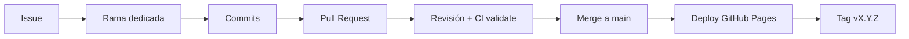

# Flujo de trabajo y gestión de la configuración

## Ramas

| Rama | Propósito | Vida |
|---|---|---|
| `main` | Código estable. Cada push dispara validación + despliegue en GitHub Pages | Permanente |
| `feature/<nombre>` | Nueva funcionalidad | Hasta el merge del PR |
| `fix/issue-<n>-<nombre>` | Corrección de un Issue | Hasta el merge del PR |
| `release/vX.Y.Z` | Changelog y subida de versión | Hasta el merge del PR |
| `docs/<nombre>` | Documentación | Hasta el merge del PR |

`main` no recibe commits directos desde el Issue #1 en adelante: todo cambio entra por **Pull Request** con al menos una revisión de otro integrante (el merge lo realiza un integrante distinto al autor).

## Ciclo de un cambio



## Convención de commits
`tipo(ámbito): descripción` → `feat`, `fix`, `style`, `docs`, `ci`, `test`, `chore`.

## Versionamiento semántico

| Cambio | Incremento | Ejemplo |
|---|---|---|
| Incompatible con versiones previas | MAJOR | 2.0.0 |
| Nueva funcionalidad compatible | MINOR | 1.0.0 → **1.1.0** |
| Corrección de error compatible | PATCH | 1.1.0 → **1.1.1** |

La versión debe coincidir en `package.json`, `js/app.js` (`APP_VERSION`), el pie de `index.html` y la entrada superior de `CHANGELOG.md`. `npm run validate` lo comprueba y bloquea el despliegue si hay diferencias.

## Publicar un release
```bash
git tag -a v1.1.1 -m "v1.1.1 - Corrección del filtro En proceso"
git push origin main --tags
```
Luego, en GitHub: *Releases → Draft a new release →* elegir la etiqueta y pegar las notas del `CHANGELOG.md`.

## Autoría de commits
Cada integrante configura su correo de GitHub:
```bash
git config user.name  "Nombre Apellido"
git config user.email "correo-de-su-cuenta-github"
```
| Integrante | Correo |
|---|---|
| Julissa Lescano Paredes | glescanop@unemi.edu.ec |
| Kevin Barboza Cargua | kbarbozac@unemi.edu.ec |
| Dayanara Rosario Guerrero Jara | dayaguerrero361@gmail.com |
| Javier Quinteros Pacheco | javicsoftcode@gmail.com |

Verificación: `git shortlog -sne --all`
